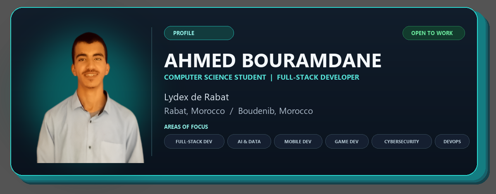

<div align="center">

<!-- ============ TYPING ANIMATION ============ -->


<!-- ============ PERSONAL IDENTITY CARD ============ -->

<p align="center">
  
</p>

<!-- ============ PROFILE ============ -->

<p align="center">
  <strong>PROFILE</strong><br/>
</p>

<table align="center">
  <tr>
    <td align="center">
      <strong>AVAILABILITY</strong><br/>
      
    </td>
    <td align="center">
      <strong>FOCUS</strong><br/>
      
    </td>
    <td align="center">
      <strong>LOCATION</strong><br/>
      
    </td>
  </tr>
</table>

<p align="center">
  
</p>

<!-- ============ CONNECT ============ -->

<p align="center">
  <strong>CONNECT</strong><br/>
  <a href="https://github.com/ahmedbouramdane"></a>
  <a href="https://linkedin.com/in/ahmedbouramdane"></a>
  <a href="https://instagram.com/ahmedbouramdane77"></a>
</p>

<!-- ============ EXPLORE ============ -->

<p align="center">
  <strong>EXPLORE</strong><br/>
  <a href="#about-me"></a>
  <a href="#-tech-stack"></a>
  <a href="#-github-analytics"></a>
  <a href="#-featured-projects"></a>
  <a href="#-contribution-graph"></a>
  <a href="#-lets-connect"></a>
</p>

<!-- ============ ANIMATED DIVIDER ============ -->


</div>

## About Me

<p align="center">
  <strong>Computer science student</strong><br/>
  Building practical software across web, mobile, AI, and interactive projects.
</p>

<table>
  <tr>
    <td width="33%" valign="top">
      <strong>FULL-STACK DEVELOPMENT</strong><br/><br/>
      Creating complete products, from backend services and APIs to thoughtful web interfaces.
    </td>
    <td width="33%" valign="top">
      <strong>AI &amp; DATA</strong><br/><br/>
      Exploring data analysis, visualisation, retrieval-augmented generation, and fine-tuning.
    </td>
    <td width="33%" valign="top">
      <strong>MOBILE DEVELOPMENT</strong><br/><br/>
      Bringing useful, well-designed product experiences to mobile devices.
    </td>
  </tr>
  <tr>
    <td width="33%" valign="top">
      <strong>GAME DEVELOPMENT</strong><br/><br/>
      Prototyping interactive ideas and learning through projects with Godot.
    </td>
    <td width="33%" valign="top">
      <strong>CYBERSECURITY</strong><br/><br/>
      Building security awareness into the way I learn, design, and develop software.
    </td>
    <td width="33%" valign="top">
      <strong>DEVOPS &amp; DELIVERY</strong><br/><br/>
      Learning to package, automate, and deliver projects with Docker, Kubernetes, and CI/CD.
    </td>
  </tr>
</table>

<blockquote>
  I value clear architecture, performance, and a good developer experience. I like taking an idea from the first sketch to a useful, working product.
</blockquote>

<div align="center">
  
</div>

## ⚡ Tech Stack

### 🎨 Frontend

<p align="center">
  
</p>

<p align="center">
  
  
  
  
</p>

### 🛠️ Backend

<p align="center">
  
</p>

<p align="center">
  
  
  
  
  
</p>

### 🗄️ Databases

<p align="center">
  
</p>

<p align="center">
  
  
  
  
</p>

### 🤖 AI & Data Analysis

<p align="center">
  
</p>

<p align="center">
  
  
  
  
  
  
</p>

### 🔎 RAG & Fine-Tuning

<p align="center">
  
  
  
  
  
  
  
</p>

### 🎮 Game Dev

<p align="center">
  
</p>

<p align="center">
  
  
  
</p>

### ☁️ DevOps & Project Management

<p align="center">
  
</p>

<p align="center">
  
  
  
  
  
  
</p>

<div align="center">
  
</div>

## 📊 GitHub Analytics

<table width="100%">
  <tr>
    <td width="58%">
      
    </td>
    <td width="42%">
      
    </td>
  </tr>
</table>

<p align="center">
  
</p>

<div align="center">
  
</div>

## 🚀 Featured Projects

<table>
  <tr>
    <td>
      <a href="https://github.com/ahmedbouramdane/Students_management_system_FastAPI">
        
      </a>
    </td>
    <td>
      <a href="https://github.com/ahmedbouramdane/laravel-app1">
        
      </a>
    </td>
  </tr>
  <tr>
    <td>
      <a href="https://github.com/ahmedbouramdane/LLM_VectorDBs">
        
      </a>
    </td>
    <td>
      <a href="https://github.com/ahmedbouramdane/3D-Game-Arduino">
        
      </a>
    </td>
  </tr>
  <tr>
    <td>
      <a href="https://github.com/ahmedbouramdane/Data_analytics_with_python">
        
      </a>
    </td>
    <td>
      <a href="https://github.com/ahmedbouramdane/My-Lydex-Study-Flutter-App">
        
      </a>
    </td>
  </tr>
</table>

<div align="center">
  
</div>

## 🐍 Contribution Graph

<p align="center">
  
  <b>Commit often — the graph never lies</b>
  
</p>

<p align="center">
  
</p>

<details>
<summary>🐍 <b>Upgrade this to the animated contribution snake</b> — one-time setup</summary>

<br/>

**Step 1** — add this workflow to your profile repo as `.github/workflows/snake.yml`:

```yaml
name: generate snake

on:
  schedule:
    - cron: "0 0 * * *"
  workflow_dispatch:
  push:
    branches: [main]

jobs:
  generate:
    runs-on: ubuntu-latest
    permissions:
      contents: write
    steps:
      - name: Generate contribution snake
        uses: Platane/snk/svg-only@v3
        with:
          github_user_name: ${{ github.repository_owner }}
          outputs: |
            dist/github-snake.svg?color_snake=#00FFE0&color_dots=#ebedf0,dark#161b22,ffe0ffe0,dark#30363d

      - name: Publish to the output branch
        uses: crazy-max/ghaction-github-pages@v4
        with:
          target_branch: output
          build_dir: dist
        env:
          GITHUB_TOKEN: ${{ secrets.GITHUB_TOKEN }}
```

**Step 2** — run the workflow once (*Actions → generate snake → Run workflow*), then swap the graph above for this block:

```html
<picture>
  <source media="(prefers-color-scheme: dark)" srcset="https://raw.githubusercontent.com/ahmedbouramdane/ahmedbouramdane/output/github-snake-dark.svg">
  
</picture>
```

</details>

<div align="center">
  
</div>

## 💬 Words I Code By

<p align="center">
  
</p>

<details>
<summary><h3>🔍 Decrypt my profile — Level 5 clearance required</h3></summary>

<br/>

```typescript
interface DeveloperProfile {
  readonly id: string;
  readonly codename: string;
  readonly location: string;
  readonly education: string;
  readonly stack: {
    frontend: string[];
    backend: string[];
    databases: string[];
    aiData: string[];
    ragFineTuning: string[];
    gameDev: string[];
    devops: string[];
  };
  readonly availability: string;
}

const AHMED_BOURAMDANE: DeveloperProfile = {
  id: "CS-LYDEX-AB-001",
  codename: "NeoCoder_Morocco",
  location: "Rabat, Morocco 🇲🇦 (UTC+1)",
  education: "Lydex de Rabat — Computer Science",

  stack: {
    frontend: ["Next.js", "React", "Tailwind CSS", "Bootstrap", "Sass/SCSS", "Less", "CSS"],
    backend: ["FastAPI", "Laravel", "Flask", "Django", "Express.js"],
    databases: ["PostgreSQL", "MySQL", "SQLite3", "MongoDB"],
    aiData: ["Python", "NumPy", "Pandas", "Matplotlib", "Seaborn", "PyTorch", "scikit-learn"],
    ragFineTuning: ["RAG pipelines", "Vector DBs", "Embeddings", "LoRA / PEFT", "Prompt engineering"],
    gameDev: ["Godot", "GDScript", "Blender"],
    devops: ["Docker", "Kubernetes", "GitHub Actions", "Agile / Scrum", "Kanban"],
  },

  availability: "Open to: Internships | Freelance | Full-time | Collaborations",
};

export default AHMED_BOURAMDANE;
```

</details>

<div align="center">
  
</div>

## 🤝 Let's Connect

Have an opportunity, project idea, or question? Choose a channel below — I'd be happy to hear from you.

<p align="center">
  <a href="mailto:a.bouramdnae.se24@lydex-se.ma"></a>
  <a href="https://wa.me/212633977491"></a>
  <a href="https://linkedin.com/in/ahmedbouramdane"></a>
</p>

<p align="center">
  <a href="https://github.com/ahmedbouramdane"></a>
  <a href="https://instagram.com/ahmedbouramdane77"></a>
</p>

<p align="center">
  
</p>

<div align="center">
  
</div>

---

<div align="center">

### ⭐️ Engineered by [Ahmed BOURAMDANE](https://github.com/ahmedbouramdane)

#### 💻 Lydex de Rabat • Morocco • v3.0.0

<p>
  
  
  
</p>

</div>
